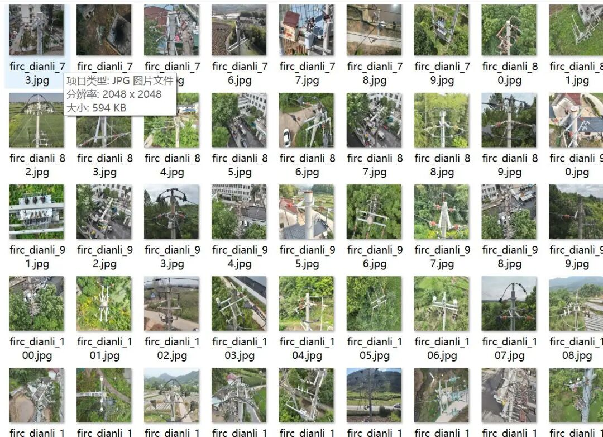
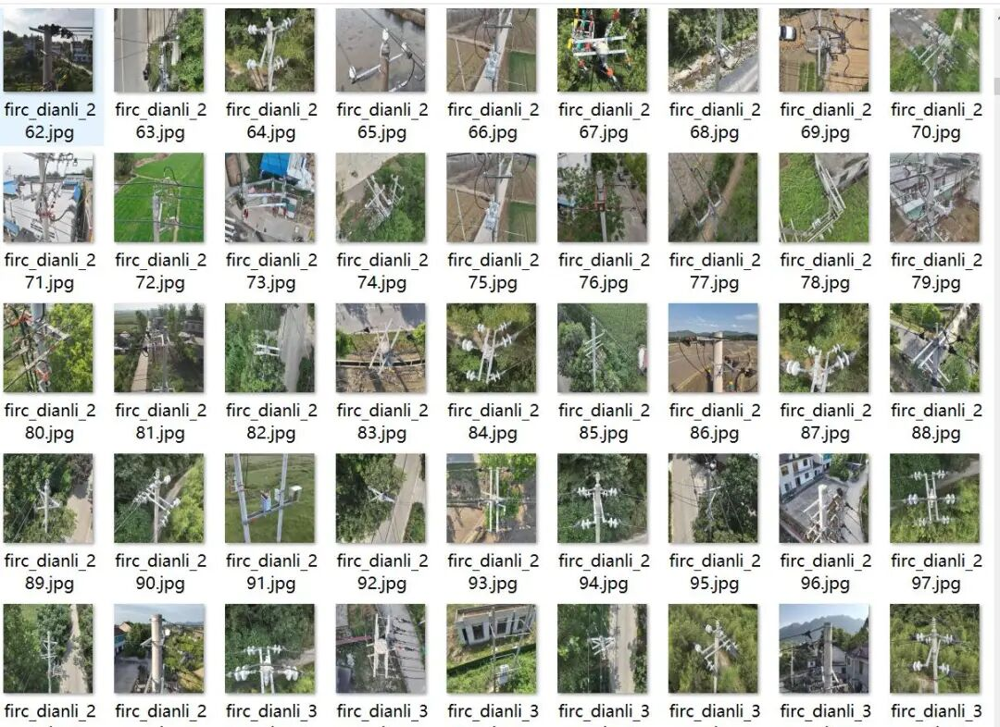
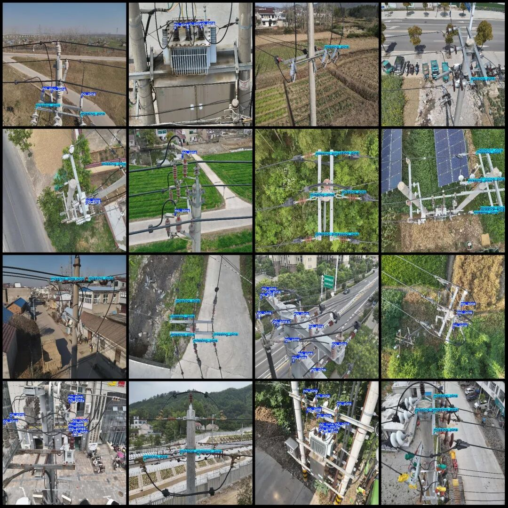
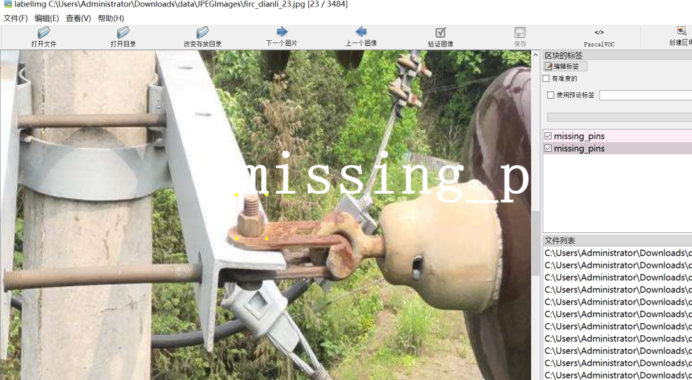

# High-definition UAV viewpoint of power scene with defect detection dataset for VOC+YOLO format, 3484 images in 2 categories

Dataset format: Pascal VOC format + YOLO format (txt file without split path, only containing jpg images and corresponding VOC format xml files and yolo format txt files)

Number of images (number of jpg files): 3484

Number of annotations (number of xml files): 3484

Number of annotations (number of txt files): 3484

Labeling category count: 2

Label category names (note that the order of categories in the YOLO format does not correspond to this, but is based on the labels folder's classes.txt): ["missing_pins", "no_pins"]

Number of boxes labeled in each category:

missing_pins (Pin Missing) Frame Count = 10395

no_pins (boltless) frame count = 6844

Total frames: 17239

Using labelImg:

Annotation rules: Draw a rectangle around the category.

Image resolution: 2048x2048

Important Notice: No

Special : This dataset does not guarantee the accuracy of the trained models or weight files.

Image Preview:

Annotation examples (randomly select 16 images to show the annotation situation):

Zoom display:

## Payment

Here is a pay link on Stripe ( https://buy.stripe.com/3cs8yP7sY87d0vu9AB ). Please contact me lonlonago@foxmail.com after funding $89, and I will send you a complete data files , thank you!

